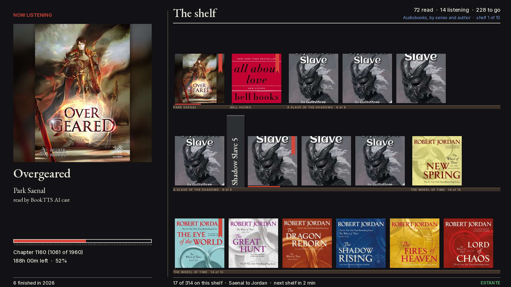
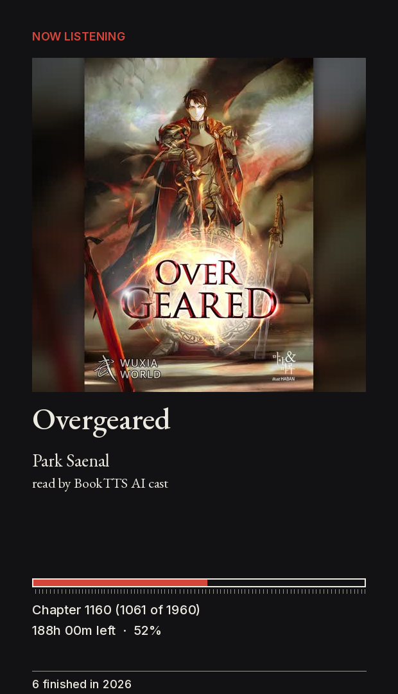
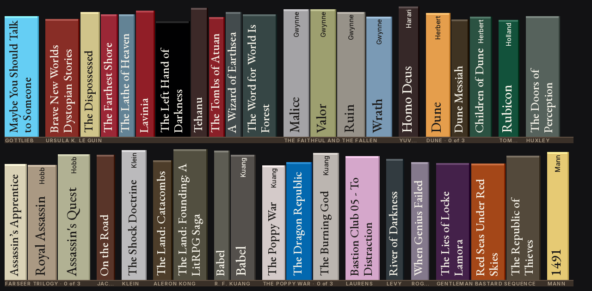
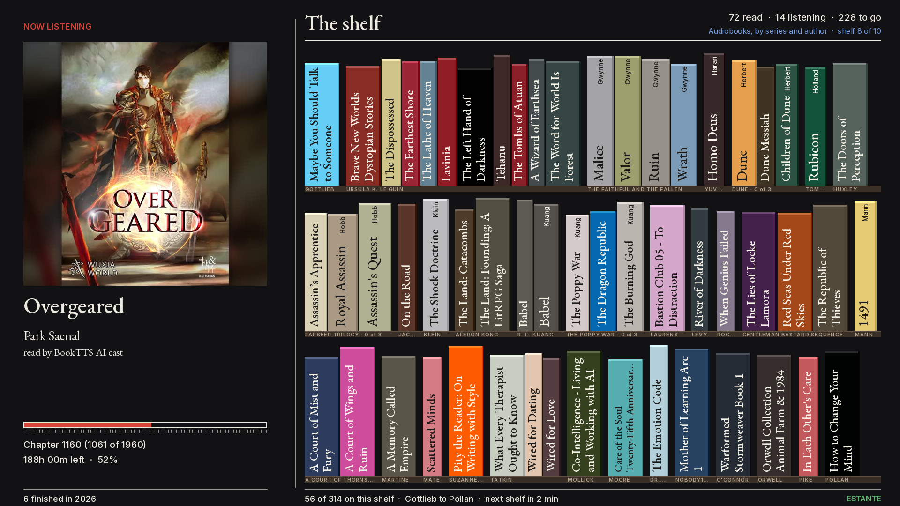
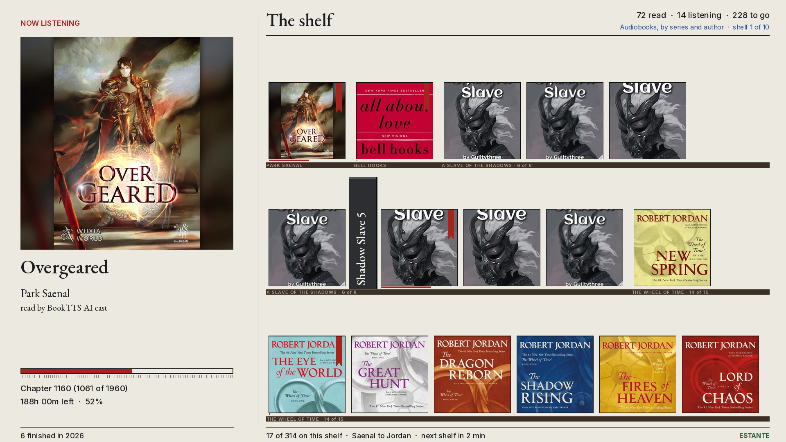

# estante

An Audiobookshelf library as a bookshelf on a screen. A Raspberry Pi draws one
1920x1080 picture straight into the Linux framebuffer, no browser and no desktop:
the book you are listening to on the left, and on the right your library as books
standing on wooden boards, spines for the unread, covers facing out for the finished
and the in-progress, grouped by series and ordered by what you are doing.



## The problem

An audiobook library lives in an app. You see it when you open the app, which is when
you already know what you want. A shelf in a room works the other way around: it is
there when you are not looking for anything, and the books you have not got to yet
look back at you. Audiobookshelf has no such view, and a grid of three hundred
thumbnails on a wall-mounted screen is not one either; a cover 66 pixels wide is a
coloured square, not a book, and dimming the unread ones to tell them apart just makes
most of the wall hard to read.

So estante draws a shelf. Spines you can read from a desk two metres away, covers
turned out for the books that have been opened, and a layout a librarian would
recognise.

## What it does

**Now listening.** The left column is the book in progress: the cover large, title,
author, narrator, a progress bar with a tick per chapter, the current chapter, the
time left and how many books were finished this year. With nothing in progress it
shows the last finished book, and with no history at all, NOTHING PLAYING. The footer
carries a message mark for a house intercom, posted over HTTP by whatever owns it.



**The shelf.** Unread books stand as spines in the dominant colour of their cover,
title reading bottom to top, thicker for longer books. Finished books face out with
their cover. Books being listened to face out with a red ribbon and a red progress
line along the base. Three wooden boards per shelf, with a small label on the board
under each run of books.



**Organised by series, ordered by activity.** A series is one run with its volumes in
order and a label such as `THE WHEEL OF TIME · 14 of 15`; everything else groups by
author. Runs with a book in progress come first, then series with finished books
(latest first), then the rest by surname. A run stays on one board whenever it fits,
and a series too long for one board carries its label onto the next. A library of
three hundred audiobooks fills about ten shelves; the panel turns to the next one every
two minutes, or on request, and jumps once to the shelf that holds a book you have
just started.

**Readable from the desk.** Spine type is 26 to 30 px on a 1080p panel. A title that
does not fit one line wraps to a second line and the spine widens to hold it, like a
hardback among paperbacks, rather than ending in three dots. Before any title is set,
it is cleaned of the noise that comes with ripped and scraped metadata: `(Unabridged)`,
`(Full-Cast Edition)`, a `(The Poppy War, Book 3)` that repeats the series, a LibriVox
`by Joaquim Maria Machado de Assis (1839 - 1908)` tail, an inverted `Alienista, O`.
When the cleaned title still does not fit two lines, the subtitle goes before the
title does. On a real library of 225 unread books this took the number of cut titles
from 57 to 1. Shelf labels fall back the same way: a full author name that does not
fit becomes the surname, credentials such as `PsyD, MFT` are never mistaken for one,
and a seven-author title becomes `PIKE`.



**It follows your listening.** The Pi asks Audiobookshelf every 60 seconds and redraws
when something on screen changed: a new chapter, the time left, a finished book, a new
book. Audiobookshelf is only ever read with GET requests. Nothing here writes progress,
marks a book finished or starts a scan.

**It takes orders over HTTP.** One small endpoint on the Pi: a voice assistant posts
"next shelf" and "show shelf three", a home automation posts the screen on or off with
presence and the time of day, an intercom posts its message-waiting flag, and anyone
can read what is on screen.

**Two themes.** `dark`, near-black with warm off-white type, and `paper`, the look it
had when it was going to be an e-ink panel.



## How it is built

**No browser.** `estante-ctl` is a single-process Python service with no dependencies
beyond Pillow. It composes the frame with Pillow, rotates it when the monitor stands
upside down, converts it to the framebuffer's pixel format (16 bpp RGB565 on the Pi)
and writes it to `/dev/fb0`. Screen off is the framebuffer's own DPMS blank through
sysfs. A full frame takes 0.8 s on a Pi 3B+; the densest shelf 0.8 s the first time
and much less after, because every drawn spine is kept.

**Pure layout, cached twice.** `spine_text.py` decides how a title sits on a spine
(size, lines, width) as a pure function of the cleaned title, the base width and the
spine height, so packing and drawing cannot disagree. Text widths are estimated from
cached glyph advances and only measured for real inside a band around the limit, which
is what makes planning ten shelves cheap on a 2016 CPU. Shelf plans are cached by a
fingerprint of the library, and spine colours are computed once per cover and kept on
disk.

**Series from the library's own metadata.** Runs come from Audiobookshelf's series
field (volume numbers included) and the author field; the ordering uses finish dates
and last-played times from the user's progress, nothing else.

**Tested against a recorded library.** The suite (370 tests, warnings as errors) runs
against recorded Audiobookshelf responses through a local fake server, draws real
pixels and asserts on them, and times the heaviest shelf. There is a self-test for the
Pi that renders the same fixtures through the same path as the service and checks the
framebuffer geometry.

## Running it

### Hardware

- Any HDMI screen. This one is a 15.6 inch 1920x1080 portable monitor on its own 5 V
  adapter; it stands on its cover rotated 180 degrees, so the installer sets
  `rotate: 180`. It sends no EDID, so the installer also forces the video mode on the
  kernel command line.
- A Raspberry Pi 3B+ or better, running Raspberry Pi OS Lite (Trixie, Python 3.13).
  Estante owns HDMI and `/dev/fb0` and uses no GPIO, so it shares the Pi happily with
  other services.
- An Audiobookshelf server on the same network and an API token for it. The token is
  used for GET requests only.

### Install on the Pi

```bash
sudo apt-get update
sudo mkdir -p /opt/estante && sudo chown "$USER":"$USER" /opt/estante
git clone https://github.com/2incertus/estante.git /opt/estante
cd /opt/estante
sudo scripts/install.sh --abs-url http://your-audiobookshelf:13378 --rotate 180
sudo reboot   # when the installer says REBOOT NEEDED
```

The installer asks for the Audiobookshelf token at a hidden prompt. Without a
terminal, pass it through the environment or a file instead:

```bash
read -rs ESTANTE_ABS_TOKEN; export ESTANTE_ABS_TOKEN
sudo --preserve-env=ESTANTE_ABS_TOKEN scripts/install.sh
unset ESTANTE_ABS_TOKEN
# or: a file holding only the token, mode 600
sudo scripts/install.sh --abs-token-file /root/abs-token
```

Never put the token on the command line: sudo logs the whole command, `ps` shows it
for the whole run and the shell keeps it in its history. `--abs-token TOKEN` is
refused on a real run and only accepted with `--dry-run`.

`scripts/install.sh` is idempotent and prints what it did or that the work was already
done. It installs the few apt packages it needs, creates a venv with the Pillow wheel
(never compiled on the Pi), writes `/etc/estante/estante.json` at mode 600 (looking the
library id up with one GET when it is not given, and checking a new token with one
`GET /api/me` before anything is touched), forces
`video=HDMI-A-1:1920x1080@60D vt.global_cursor_default=0 consoleblank=0` on the kernel
command line (keeping a backup of the original), disables the tty1 login so nothing
draws over the frame, installs and enables the systemd unit (whose `ExecStartPre`
unbinds the kernel console from the framebuffer), waits for `GET /state` to answer,
and runs the self-test. `--dry-run` prints the whole plan without changing anything.

Logs: `journalctl -u estante-ctl -f`. After a code update:
`sudo systemctl restart estante-ctl`.

### Configuration

`/etc/estante/estante.json`, read at start (path from `ESTANTE_CONFIG` in the unit).
Missing keys take the defaults shown.

| Key | Default | Meaning |
|-----|---------|---------|
| `listen`, `port` | `0.0.0.0`, `8360` | the HTTP API; no auth, so keep it on the LAN |
| `abs_url`, `abs_token` | empty | Audiobookshelf base URL and API token (GET only); the reason the file is mode 600 |
| `theme` | `dark` | `dark` or `paper` |
| `walls` | one wall | ordered list of `{"name", "library_id", "title"}`; an empty `library_id` is resolved from the library whose name matches `name` |
| `poll_seconds` | `60` | how often Audiobookshelf is read |
| `wall_refresh_minutes` | `15` | the wall's library is read again at least this often |
| `shelf_minutes` | `2` | the shelf turns to its next section this often (not while the screen is off) |
| `state_dir` | `/var/lib/estante` | `state.json`, the cover cache and `spines.json` (each cover's spine colour) |
| `canvas` | `[1920, 1080]` | size the composition is drawn at; scaled to the framebuffer when they differ |
| `rotate` | `0` | `0` or `180` |
| `fb_device`, `fb_sysfs` | `/dev/fb0`, `/sys/class/graphics/fb0` | the framebuffer and its sysfs directory (geometry, `blank`) |
| `fb_file`, `fb_size`, `fb_bpp` | empty, `[1920, 1080]`, `16` | write frames to a regular file instead of a device (development) |
| `cover_width` | `200` | width of the shelf's cached covers; 200 keeps the 186 px face-outs sharp |
| `now_cover_width` | `520` | width of the Now listening cover |

A second wall is one more entry in `walls`; `/show {"screen": "<name>"}` switches to
it.

### The HTTP API

All on port 8360, JSON in and out, no auth. Every write answers 202 and happens on
the render thread.

| Call | Body | Effect |
|------|------|--------|
| `POST /swap` | none | the next shelf section now; the timer restarts. Answers `{"queued": "next_shelf", "section": k}` |
| `POST /show` | `{"section": k}` | that section (from 1); 404 with `{"sections": n}` when there is none |
| `POST /show` | `{"screen": "<wall>"}` | that wall, at the section it was last on |
| `POST /screen` | `{"on": bool, "dim": 0..1}` | power through the framebuffer's blank; `dim` multiplies the frame's brightness. A bare `{"on": true}` restores full brightness |
| `POST /badge` | `{"message_waiting": bool, "dnd": bool, "from": "<name>", "count": n}` | the message mark in the Now listening footer |
| `GET /state` | | `{"wall", "walls", "shelf": {"section", "sections", "next_turn"}, "badge", "screen", "busy", "last_render", "now_listening": {"item_id", "title", "pct"}}` |

### Home Assistant

The policy lives in Home Assistant; the Pi only obeys. `ha/estante_screen.yaml` holds a
`rest_command` that posts to `/screen` and four automations on an office-presence
boolean: occupied between 07:00 and 23:30 turns the screen on, the office empty turns
it off, 23:30 turns it off whatever happens, 07:00 turns it on when the office is
already occupied. Voice phrases for a Home Assistant Assist pipeline ("next shelf",
"show shelf three", "screen off") are three more automations posting to the same
endpoint.

### Development without a Pi

```bash
python3 -m venv .venv && .venv/bin/pip install -r requirements-dev.txt
.venv/bin/pytest -q -W error                       # the whole suite, about 90 s
.venv/bin/python scripts/selftest.py               # what the installer runs on the Pi
bash scripts/install.sh --dry-run --library-id ID --abs-token x
ESTANTE_STATE_DIR=/tmp/estante-state .venv/bin/python scripts/preview.py \
    --env abs.env --theme dark --section 2 --badge --out out --fb-file out/fb.raw
```

`scripts/preview.py` reads `ABS_URL` and `ABS_TOKEN` from the env file (GET only, the
token is never printed) and renders the live composition exactly as the service would
draw it: `--section N`, `--theme dark|paper`, `--dim 0..1`, `--badge`, `--dnd`. With
`--fb-file` it also writes the frame as RGB565 framebuffer bytes, reads them back and
checks every pixel round-trips within the 5/6/5 rounding. The screenshots in this
README are its output on a real library.

## Notes from building it

**It was going to be e-ink.** The first version drove a 7.3 inch Spectra 6 panel
through InkyPi, with every pixel snapped to the driver's six-colour palette so the
quantize pass was a no-op. The panel never arrived; a portable HDMI monitor already in
a drawer did, and it turned out to be the better screen for a shelf you read from
across a room. The e-ink build is kept under the tag `inkypi-v1`, and its paper look
survives as the `paper` theme.

**The framebuffer is 16 bpp.** Raspberry Pi OS on KMS gives a 1920x1080 RGB565 buffer
with a 3840-byte stride, and only when a screen answers on HDMI, which a monitor
without EDID never does. Hence the forced mode on the kernel command line. Pillow has
no 16-bit raw encoder, so the conversion is done with integer array arithmetic in C
through Pillow's own ops, 0.2 s per frame on the Pi.

**The cover wall was the wrong idea.** Version two drew every cover as a tile, dimmed
the unread ones and framed the in-progress ones in red. It was accurate and
unreadable. The shelf came from asking what a room would do with the same information:
spines for what has not been opened, faces for what has.

**Readability is a ladder, not a font size.** The spine typesetter tries, in order: one
line at 30 px; one line at 26 px; one line at 26 px using the room reserved for the
author's surname; two lines at 26 px on a wider spine, breaking long words at hyphens;
the same without the subtitle; two lines at 22 px; and only then an ellipsis. The
first version of the large type still cut 57 of 225 unread titles, most of them
because two-line spines were reserving space for a surname they never drew.

## Tests

```bash
.venv/bin/pytest -q -W error
```

370 tests against recorded fixtures (a real library of 311 audiobooks and 597 light
novels, three items with progress, 19 covers) through a fake Audiobookshelf server:
the data model and run ordering, the typesetting ladder title by title, label
fallbacks, real-pixel checks on drawn spines, ribbons and progress lines, the shelf
planner, the conductor's HTTP routes and timers, the framebuffer writer against a file,
the installer's dry run, and a timing gate on the heaviest shelf.

## License

GPL-3.0, see `LICENSE`. EB Garamond and Inter are under the SIL Open Font License 1.1
(`plugins/estante_lib/fonts/OFL.txt`). The cover images in the test fixtures and
screenshots belong to their publishers.
